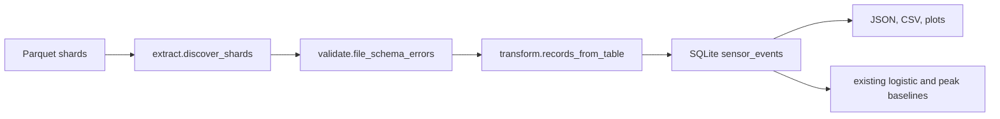
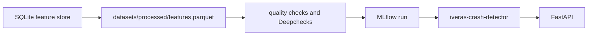

# Accident detection on VZCrash

Crash detection from 16-second ego-vehicle IMU and GPS windows. The released model was chosen on the official validation split and scored **once** on the official test split.

**Frozen test result:** precision **0.8244**, recall **0.9173**, F1 **0.8684**, average precision **0.9273**.

That number is the end of a four-phase study, not a tuned leaderboard entry. An earlier logistic model looked strong on ranking quality and then predicted crashes for 10,593 of 12,087 rows in a test shard that contains **zero** crashes. The fix was to remove a storage-count feature, not to search thresholds on the test set.

Dataset: [VZCrash](https://huggingface.co/datasets/vzc-research-chapter/VZCrash) (Bianconcini et al., IEEE ITSC 2026, CC BY-NC 4.0). Raw Parquet is not in this repository.

## Result a reviewer can check

| | Precision | Recall | F1 | Balanced accuracy | Average precision | False positives | False negatives |
| --- | ---: | ---: | ---: | ---: | ---: | ---: | ---: |
| Official test, pooled | 0.8244 | 0.9173 | 0.8684 | 0.9380 | 0.9273 | 825 | 349 |
| `test-00000` | 0.9465 | 0.9173 | 0.9317 | 0.9447 | 0.9744 | 219 | 349 |
| `test-00001` (0 crashes) | undefined | undefined | undefined | undefined | undefined | 606 | 0 |

Confusion on the pooled test, rows `[non-crash, crash]`: `[[19128, 825], [349, 3872]]`.

`test-00001` has no positive labels, so precision, recall, F1, and average precision are undefined there. The 606 false positives are the stress check.

Selection rule, fixed before that score:

- Model: highest **validation** average precision. Ties break by model name.
- Threshold: maximum **validation** crash F1. Ties keep the lower score.
- No missed-crash versus false-alarm cost was supplied, so F1 is the documented balanced point, not a hidden optimum.

| Candidate | Validation AP | Precision | Recall | F1 | FP | FN | Threshold |
| --- | ---: | ---: | ---: | ---: | ---: | ---: | ---: |
| Acceleration peak | 0.8848 | 0.7815 | 0.8912 | 0.8328 | 1,060 | 463 | 1.9937 g |
| Acceleration-only logistic | 0.9079 | 0.7964 | 0.9065 | 0.8479 | 986 | 398 | 0.5811 |
| **Defensible logistic (selected)** | **0.9227** | **0.8169** | **0.9156** | **0.8635** | **873** | **359** | **0.6152** |

At probability 0.5 the selected model has validation recall 0.9384 and 1,060 false positives. The frozen operating point is the F1 threshold above. Config: `reports/phase4/experiment_config.json`. Curves: `reports/phase4/figures/`.

## Class balance

Counts are the official shard labels in `reports/phase4/phase4_results.json`. Positive means crash. Negative means near-miss plus normal driving. No rows were removed.

| Split | Rows | Crash (positive) | Near-miss | Normal | Negative | Positive rate | Negatives per positive |
| --- | ---: | ---: | ---: | ---: | ---: | ---: | ---: |
| Train | 137,954 | 22,603 | 20,802 | 94,549 | 115,351 | 0.1638 | 5.10 |
| Validation | 27,175 | 4,255 | 4,246 | 18,674 | 22,920 | 0.1566 | 5.39 |
| Test | 24,174 | 4,221 | 3,633 | 16,320 | 19,953 | 0.1746 | 4.73 |

`test-00001` is entirely negative (12,087 rows, 0 crashes), so its precision-recall curve is undefined. The pooled test curve still includes those negatives.

The splits are imbalanced, about five negatives per crash. **The baseline and the logistic models were evaluated on that natural distribution. No class was oversampled, undersampled, or duplicated.**

What was done instead:

- The acceleration-peak baseline uses no class weight. Its threshold is the validation crash-F1 point. Precision and recall for that model are computed on the original validation and test rows.
- Logistic regression sets `class_weight="balanced"` (`baselines.py`). That changes the loss weight only. It does not change the rows. On the training counts, scikit-learn’s balanced formula `n / (2 * count)` gives weight **3.052** for crash and **0.598** for non-crash.
- Precision, recall, F1, and average precision are computed with the original labels (`metrics.py`). They are not computed on a resampled set.

On the validation precision-recall curves, all three candidates stay near precision 0.9 through the middle of the recall range. The selected model’s validation point is precision 0.8169 at recall 0.9156 (average precision 0.9227). The frozen test curve has the same shape: precision stays high until recall approaches 1, then falls. The reported test point, precision 0.8244 at recall 0.9173, sits on that shoulder. Test average precision is 0.9273, against a positive rate of 0.1746. A precision-recall curve was not drawn for `test-00001` because that shard has no crashes.

## What the model uses

Positive class: crash (`label` 0). Near-miss and normal driving stay negative. No class is resampled.

The selected model is class-weighted logistic regression (`C=1`, `lbfgs`, seed 0) on features fit with a training-only median imputer and standard scaler:

- horizontal and vector acceleration peaks, longitudinal min and max, horizontal standard deviation
- GPS start, end, minimum, and drop
- Light, Medium, and Heavy vehicle-size indicators (Unknown is the reference)

Left out on purpose, before any test score:

| Feature | Why it is excluded |
| --- | --- |
| `gps_samples`, `imu_samples`, `gyro_samples` | List length is a storage count. On one training shard, GPS length 17 was 23.38 training standard deviations above the mean and added about **+7.42** to the logit. |
| `gyro_is_hd` | Resolution flag. Standardization does not put 1 deg/s and 0.001 deg/s encodings on one scale. |
| Gyroscope peak and spread | Standard rows reach 32,766 deg/s and, in one validation shard, 2,147,483.75 deg/s. High-definition peaks top out near 1,394 deg/s. |

The acceleration-peak baseline is `max hypot(accel_x, accel_y)`. On the one-shard test split it reproduced the paper's reported physical-baseline average precision of **0.8962**.

## Why the first logistic model failed

Phase 2 fit one training shard (12,542 rows, 245 crashes) and scored both official test shards (24,174 rows).

| Model | Test precision | Recall | F1 | Average precision |
| --- | ---: | ---: | ---: | ---: |
| Acceleration peak, threshold 2.2016 g | 0.8158 | 0.8593 | 0.8370 | 0.8962 |
| Full logistic, probability 0.5 | 0.2733 | 0.9964 | 0.4289 | 0.9243 |

The full model’s average precision was high and its operating point was not. On `test-00001` it predicted **10,593** crashes. Training GPS length was almost always 16, so the training scale of `gps_samples` was 0.0428. The second test shard stores length 17 on 10,948 of 12,087 rows. `gyro_is_hd` had coefficient 0 because that shard had no high-definition rows.

Those test numbers were diagnostic. They were not used to pick the Phase 4 model.

## Data, kept intact

| Split | Shards | Rows | Crash labels |
| --- | ---: | ---: | ---: |
| Train | 11 | 137,954 | 22,603 |
| Validation | 3 | 27,175 | 4,255 |
| Test | 2 | 24,174 | 4,221 |
| **All** | **16** | **189,303** | **31,079** |

Audit of every shard: one schema, no extra columns, 0 nulls, 0 non-finite values, 0 duplicate `event_id`s, 0 rows removed. Six accelerometer/gyroscope length mismatches were kept and summarized separately. Nothing was clipped, padded, truncated, or resampled to 1,600 IMU samples.

GPS length 17 appears in 103,187 rows. 53,144 repeat the last sample and 34,181 repeat the first (those counts overlap). 6,294 have no adjacent duplicate, so length 17 is not a single parse error.

The shards are not interchangeable draws. `train-00005` is 12,541 crashes. `train-00008` through `train-00010` contain none. There is no vehicle id, so this repository uses the official shard names and does not claim to rebuild the paper’s vehicle-disjoint split.

## Layout

```text
src/accident_detection/
  audit.py  schema.py  columns.py  signals.py     # read-only audit, no row drops
  features.py  quality.py  baselines.py  metrics.py
  experiment.py          # phase 2, pinned to the original training shard
  phase3.py  diagnosis.py # generalization diagnosis, still one training shard
  phase4.py  selection.py # train fit, validation choice, one test score
  coverage.py  protocol.py
tests/                   # 47 tests: leakage, zero-crash slices, no silent edits
reports/phase2|phase3|phase4
```

Preprocessing, coefficients, and thresholds are fit on training rows. `validation_choice` takes validation scores only. Phase 2 and Phase 3 stay pinned to `train-00000-of-00011.parquet`, so a later full download cannot silently rewrite those results.

## Run

Python 3.11. The VZCrash files are gated. Download them into `data/VZCrash/` and keep the official file names.

```powershell
python -m venv .venv
.\.venv\Scripts\python.exe -m pip install -r requirements.txt
$env:PYTHONPATH = "src"
.\.venv\Scripts\python.exe -m pytest
.\.venv\Scripts\python.exe -m accident_detection.phase4 --data-dir data/VZCrash/data --output-dir reports/phase4
```

Phase 1 audit: `python -m accident_detection.cli --data-dir data/VZCrash/data --report-dir reports/data_audit --figure-dir reports/figures`.

## Limits

- Official shard assignment is the split. It is not a reconstructed vehicle-level split.
- The threshold maximizes validation F1. A different cost ratio needs a new validation selection and a new test evaluation.
- The test metrics above were not used to change features or the threshold.
- Near-miss events are negatives, matching the dataset’s crash-detection task.
- Counts here are from this checkout (31,079 crash labels). The paper reports 31,090 verified crashes.

## ETL pipeline

The modeling commands above still read Parquet directly. A separate pipeline loads the same shards into SQLite for quality checks and for a second, equivalent evaluation. The source format is Parquet. There is no CSV release of these windows.



Raw accelerometer and gyroscope lists stay in the Parquet files. SQLite stores one row per event: `event_id`, the official split taken from the file name, the original label, vehicle size, lengths, non-finite sample counts, and the window summaries in `FEATURE_NAMES`. The primary key is `(run_id, source_file, row_index)`. `event_id` is indexed and is not forced to be unique, because a repeated id is reported rather than deleted.

| Table | What it stores |
| --- | --- |
| `pipeline_runs` | One id, timestamps, and status per invocation |
| `source_shards` | File name, split, bytes, input, accepted, and rejected counts |
| `sensor_events` | Accepted events and feature summaries |
| `rejected_records` | Row index, event id, and reason. No IMU payload |
| `data_quality_results` | Metric name, value, and scope for that run |

Foreign keys point shard rows and rejections at `source_shards`, and shard rows at `pipeline_runs`. Each invocation is one transaction. A failed insert rolls the run back. `--reset-db` is the only flag that deletes the SQLite file. Original Parquet is never deleted.

Duplicate policy: a duplicate is a repeated `event_id`, counted within a file and across files, and kept. Matching sensor summaries with different ids are not treated as duplicates. Null labels and null event ids are rejected. Other nulls stay null so the training-only imputer can still run later. Extreme gyroscope values and unusual lengths are kept. No class is resampled.

```powershell
$env:PYTHONPATH = "src"
.\.venv\Scripts\python.exe -m accident_detection.etl --input data/VZCrash/data --db data/processed/accident_detection.db --output reports/etl --reset-db
.\.venv\Scripts\python.exe -m accident_detection.etl --input data/VZCrash/data --db data/processed/accident_detection.db --output reports/etl --evaluate
```

`--dry-run` writes the quality report and does not create the database. `--evaluate` fits the existing peak, acceleration-only, and defensible logistic models on the loaded training split, selects on the loaded validation split, and scores the loaded test split once. It does not read or replace `reports/phase2`, `reports/phase3`, or `reports/phase4`.

Inspect one loaded run:

```powershell
sqlite3 data/processed/accident_detection.db "SELECT split_name, COUNT(*) FROM sensor_events GROUP BY split_name;"
```

Quality outputs: `reports/etl/etl_quality.json`, `shards.csv`, `quality_metrics.csv`, `shard_rows.png`, `class_counts.png`, and `missing_values.png`.

A full run on the 16 local shards finished in 311.918 seconds. It discovered 16 files, processed 16, failed 0, accepted 189,303 rows, and rejected 0. Duplicate event ids: 0. Missing vehicle sizes, non-finite feature values, and unexpected vehicle sizes: 0. The seven warnings are shards that are all crashes or contain no crashes; those rows were kept. `--evaluate` selected `defensible_logistic` at threshold 0.6152401422448208 and scored the test split once: precision 0.8244, recall 0.9173, F1 0.8684, average precision 0.9273, 825 false positives, 349 false negatives. Those figures match the stored Phase 4 test result. The ETL path did not improve the model. It reproduced it.

Cite Bianconcini et al., “VZCrash: A Large-Scale IMU Dataset of Ego-Vehicle Crashes,” IEEE ITSC 2026, when the data are used.

## MLOps

The serving and tracking layer uses the same `fit_logistic` and `validation_choice` functions as the study. It does not fit a second model family. There was no existing web or hardware client in this repository; the HTTP API and dashboard are new and read the registry and the report files.



Production moves only when validation average precision is at least 0.85 and validation crash recall is at least 0.85. Test labels are logged after that decision. A version that fails the gate can be registered and cannot be the rollback target.

```powershell
$env:PYTHONPATH = "src"
.\.venv\Scripts\python.exe -m pip install -r requirements.txt
.\.venv\Scripts\python.exe -m accident_detection.mlops --export --db data/processed/accident_detection.db --features datasets/processed/features.parquet --tracking-uri sqlite:///mlops/mlflow.db --reports reports/mlops
.\.venv\Scripts\dvc.exe add datasets/processed/features.parquet
$env:MLFLOW_TRACKING_URI = "sqlite:///mlops/mlflow.db"
$env:IVERAS_REPORT_DIR = "reports/mlops"
.\.venv\Scripts\python.exe -m uvicorn accident_detection.mlops.api:app --host 127.0.0.1 --port 8000
```

The React app in `frontend/` reads this API. Setup is in `frontend/README.md`. Start it with `npm run dev` after the API is up.

The tracked retrain on the exported table selected `defensible_logistic` at threshold 0.6152401422448208. Validation: precision 0.8169, recall 0.9156, F1 0.8635, average precision 0.9227, 873 false positives, 359 false negatives. Test, scored once after the gate: precision 0.8243559718969555, recall 0.9173181710495143, F1 0.8683561336622561, average precision 0.9272891281023602, 825 false positives, 349 false negatives. Those test figures match Phase 4. This run did not improve the model.

One test row, event 19088, label 2, scored as non-crash with probability 0.0134 on production version 1. The scoring call reported 1.63 ms; the mean of 50 calls on that same row was 1.51 ms.

Deepchecks 0.19.1 ran. The train/test suite passed. The data-integrity suite did not: its feature-feature correlation condition failed. The acceleration summaries are related by construction, and that result did not change the metric gate. Evidently 0.7.23 wrote `reports/mlops/drift.html` (4,519,598 bytes). The configured mean-shift threshold of 0.3 flagged the five acceleration summaries. Train and validation medians of `peak_horizontal_g` are 0.769 g and 0.761 g. The mean gap is one kept validation near-miss, event 385560, whose peak is 2,420,976 g.

`docker version` failed on this machine, so the image in `Dockerfile` was not built. `.github/workflows/mlops.yml` has not been executed from here. Google Cloud stays disabled unless `GOOGLE_APPLICATION_CREDENTIALS`, `GCP_PROJECT`, and `GCS_BUCKET` are set; no cloud API was called.

Review notes and the demonstration order are in `docs/FINAL_REVIEW.md`.
