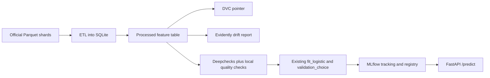
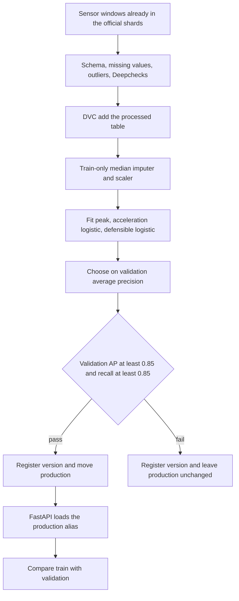

# IVERAS final review

IVERAS here is the MLOps layer on the existing VZCrash crash detector. The repository did not contain a separate sensor service, hardware UI, or HTTP API. The integration point is the SQLite feature store and the logistic pipeline in `baselines.py`.

## Architecture

Raw shards stay outside git. They are gated and about 7 GB. DVC versions the processed feature table exported from SQLite, not a second copy of the raw windows.

## Workflow

The gate reads validation metrics only. Test metrics are logged after the decision and are not an input to promotion or rollback.

## Technology

| Piece | Role in this repository |
| --- | --- |
| scikit-learn logistic pipeline | The existing model. Not reimplemented. |
| MLflow 3.18 | Parameters, precision, recall, F1, confusion matrix, pickle artifact, registry aliases |
| DVC 3.67 | Version the processed feature Parquet and the train stage |
| Deepchecks 0.19.1 | Data-integrity and train/test suites. NumPy 2 and scikit-learn 1.9 need two compatibility aliases |
| Evidently 0.7.23 | HTML drift report. Pandas 3.1 needs one restored import |
| FastAPI | `/predict`, `/predict/window`, `/mlops` |
| Docker | Image definition. The local daemon was not available, so the image was not built |
| GitHub Actions | Workflow file. It has not been executed from this machine |
| Google Cloud | Status only. No API is called unless credentials, project, and bucket are set |

## Promotion rule

Production moves only when validation average precision is at least 0.85 and validation crash recall is at least 0.85. Those floors were set before the tracked retrain. They are not a search on the test set. A registered model that fails the gate cannot become the rollback target.

## Measured retrain

Command: `python -m accident_detection.mlops --export` against `data/processed/accident_detection.db`.

| Item | Measured value |
| --- | --- |
| Rows exported | 189,303 |
| Selected model | `defensible_logistic` |
| Threshold | 0.6152401422448208 |
| Validation precision, recall, F1, AP | 0.8169, 0.9156, 0.8635, 0.9227 |
| Validation false positives, false negatives | 873, 359 |
| Test precision | 0.8243559718969555 |
| Test recall | 0.9173181710495143 |
| Test F1 | 0.8683561336622561 |
| Test average precision | 0.9272891281023602 |
| Test false positives, false negatives | 825, 349 |
| Registry | `iveras-crash-detector` version 1, production alias 1 |
| Gate | passed on validation only |

The test row matches the frozen Phase 4 result. It is a reproduction.

## Checks and drift

Deepchecks data integrity did not pass. The failing condition was feature-feature correlation. The train/test suite passed, including its leakage checks. Schema checks found no missing defensible features and no invalid labels.

Evidently wrote `reports/mlops/drift.html` (4,519,598 bytes). With the mean-shift threshold 0.3, the five acceleration summaries were flagged. Medians of `peak_horizontal_g` are 0.769 g on train and 0.761 g on validation. One kept validation near-miss, event 385560, has a peak of 2,420,976 g and moves the validation mean.

A production scoring call on test event 19088 (label 2, normal driving) returned non-crash, probability 0.0134, version 1. That call's internal timer was 1.63 ms. Fifty calls on the same row averaged 1.51 ms.

## Demonstration order

1. Show `reports/phase4` and this retrain side by side. The test metrics match.
2. Open MLflow at the local store `sqlite:///mlops/mlflow.db`, experiment `iveras-crash-detection`.
3. Show `datasets/processed/features.parquet.dvc` and `dvc.yaml`.
4. Show registry version 1 and the rollback test in `tests/test_mlops.py`.
5. Open `reports/mlops/drift.html` and `reports/mlops/quality.json`.
6. Start uvicorn and open `/mlops`, then POST `/predict` or `/predict/window`.
7. Show `Dockerfile`, `docker-compose.yml`, and `.github/workflows/mlops.yml`, and say the image and the workflow were not executed here.
8. Show `cloud_status()`: enabled false, no API called.

## What is not claimed

- No hardware or mobile client was added, because none existed to preserve.
- Vertex AI, Cloud Build, Cloud Storage, and Cloud Monitoring were not executed.
- Docker build was not executed.
- GitHub Actions was not executed.
- The tracked retrain is a reproduction of the frozen Phase 4 procedure, not a new model search.
